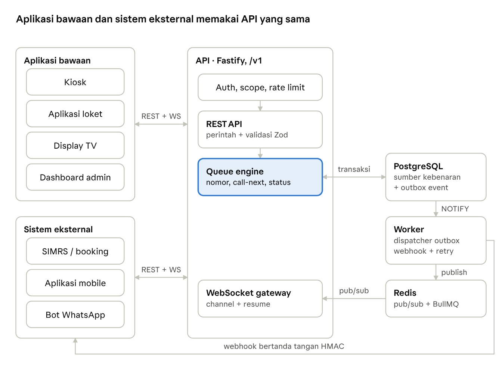
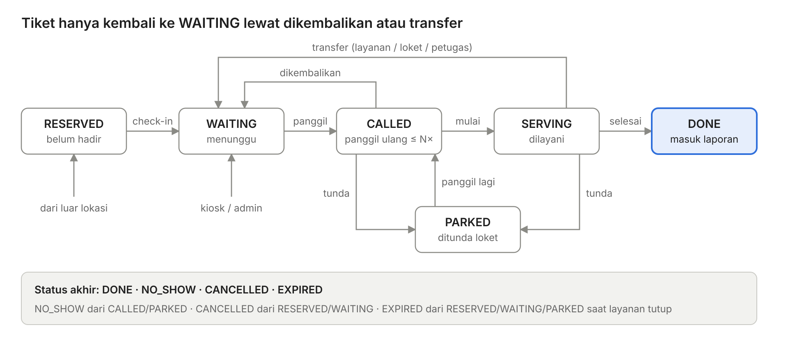

# Sistem Antrian Pelanggan — PRD & Spesifikasi Teknis

Dibuat Nov 18, 2026 · diperbarui Nov 19, 2026 · @Dendi

Keputusan arsitektur dan alasannya: [`adr/`](adr/README.md).

## Ringkasan

Kita membangun **queue engine** antrian pelanggan yang *headless* dan **serbaguna**: bisa dipakai klinik, rumah sakit, bank, kantor layanan publik, bengkel, atau ritel tanpa mengubah kode, karena aturan antrian, istilah, tampilan, dan suara diatur dari dashboard admin. Semua fungsi (ambil tiket, panggil, status, laporan) tersedia lewat API publik, sehingga sistem lain seperti SIMRS, aplikasi booking, aplikasi mobile, atau signage pihak ketiga memakai engine yang sama. Aplikasi bawaan (kiosk, loket, display, admin) hanyalah klien pertama API itu. Engine menjamin satu tiket hanya dipanggil satu loket, urutan adil (FIFO + prioritas), dan setiap perubahan status keluar realtime lewat WebSocket dan webhook.

Target MVP: platform **multi-tenant** (banyak organisasi di satu instalasi), dengan kapasitas per cabang hingga 20 loket dan 1.000 tiket per hari. Kode yang sama tetap bisa dipasang on-prem untuk satu tenant yang butuh berjalan tanpa internet.

| Komponen | Pengguna | Perangkat / kanal |
| --- | --- | --- |
| Queue engine (API) | Semua komponen di bawah | Cloud multi-tenant, atau server lokal untuk satu tenant |
| Sistem eksternal | Developer integrator | REST API v1, WebSocket, webhook, SDK JS |
| Kiosk | Pelanggan | PC/tablet layar sentuh + printer thermal 58/80 mm |
| Aplikasi loket | Operator | Browser di PC loket |
| Display | Pelanggan di ruang tunggu | Smart TV / mini PC + speaker |
| Dashboard admin tenant | Admin, manajer | Browser, `{tenant}.antrian.app` |
| Dashboard platform | Platform admin | Browser, `admin.antrian.app` |

## Bagian A — PRD

### Masalah

Antrian manual (nomor kertas atau dipanggil lisan) membuat pelanggan merasa diserobot, tidak tahu harus menunggu berapa lama, dan pihak manajemen tidak punya data waktu tunggu maupun beban tiap loket.

### Tujuan dan metrik keberhasilan

| Tujuan | Metrik | Target MVP |
| --- | --- | --- |
| Ambil tiket cepat | Waktu dari sentuh layar sampai tiket tercetak | ≤ 10 detik |
| Panggilan terlihat seketika | Jeda tombol "Panggil" sampai tampil di TV | ≤ 1 detik (p95) |
| Urutan adil | Tiket dipanggil di luar urutan tanpa alasan (prioritas/transfer) | 0 |
| Data lengkap | Tiket dengan jejak status lengkap di log | 100% |
| Transparansi | Estimasi waktu tunggu ditampilkan di tiket dan TV | Selisih ≤ 30% dari aktual |
| Siap pakai cepat | Waktu dari tenant dibuat sampai tiket pertama dicetak, memakai template industri | ≤ 30 menit |
| Serbaguna | Kebutuhan tenant yang tercakup pengaturan tetapi butuh perubahan kode | 0 |

### Persona

- **Pelanggan** — datang, pilih layanan, ingin tahu posisi dan kapan dipanggil.
- **Operator loket** — melayani satu pelanggan per waktu, butuh tombol sedikit dan jelas.
- **Supervisor** — memantau antrian cabang secara live, membuka/menutup loket, memindahkan tiket antar loket, dan menangani pengecualian.
- **Admin tenant/cabang** — mengatur cabang, layanan, loket, operator, jam buka, perangkat, branding.
- **Manajer/pemilik usaha** — melihat laporan harian: volume, waktu tunggu, waktu layanan, kinerja operator.
- **Developer integrator** — menyambungkan sistem lain (SIMRS, booking, aplikasi mobile, bot WhatsApp). Butuh dokumentasi jelas, sandbox, contoh kode, dan event yang bisa diandalkan.
- **Platform admin** — pengelola layanan ini: membuat dan menangguhkan tenant, mengatur paket dan kuota, memantau pemakaian dan kesehatan sistem.

### Prinsip produk

- **Serbaguna.** Satu engine untuk klinik, rumah sakit, bank, kantor layanan publik, bengkel, ritel, dan usaha lain. Tidak ada istilah atau aturan khusus satu industri di dalam kode.
- **Konfigurasi, bukan kode.** Semua perilaku antrian, istilah, tampilan, suara, dan tiket diatur dari dashboard admin.
- **Default yang siap pakai.** Setiap pengaturan punya nilai default yang aman. Tenant baru memilih template industri dan bisa langsung beroperasi.
- **Berlaku seketika.** Perubahan pengaturan sampai ke kiosk, loket, dan display ≤ 5 detik tanpa restart atau reload manual.
- **Bisa ditelusuri dan dikembalikan.** Setiap perubahan pengaturan tercatat (siapa, kapan, apa) dan bisa dikembalikan ke versi sebelumnya.
- **Pratinjau sebelum simpan.** Dashboard menampilkan pratinjau kiosk, tiket cetak, display, dan kalimat pengumuman.
- **Sederhana dulu.** Dashboard punya mode Sederhana (pengaturan inti) dan Lanjutan (semua pengaturan).

### Konfigurasi di dashboard admin

**Template industri.** Saat tenant dibuat, admin memilih template yang mengisi istilah, layanan contoh, kelas prioritas, dan pengaturan awal. Semua isinya bisa diubah setelahnya, dan template bisa diterapkan ulang ke cabang baru.

| Template | Istilah loket | Contoh layanan | Kelas prioritas (keunggulan waktu) | Pengaturan khas |
| --- | --- | --- | --- | --- |
| Klinik / rumah sakit | Poli, Ruang | Pendaftaran, Poli Umum, Poli Gigi, Farmasi, Kasir | Darurat (60 mnt), Lansia, Difabel, Ibu hamil (15 mnt) | Tiket remote simpan urutan; kunjungan lintas layanan |
| Bank / keuangan | Teller, CS | Teller, Customer Service, Kredit | Nasabah prioritas (20 mnt), Lansia, Difabel (15 mnt) | Kuota harian CS; display dengan teks berjalan |
| Kantor layanan publik | Loket | Pendaftaran, Pengambilan dokumen, Informasi | Lansia, Difabel, Ibu hamil (15 mnt) | Kuota harian per layanan; jam layanan sendiri |
| Bengkel / service center | Meja, Bay | Servis ringan, Servis berat, Klaim garansi | Tanpa prioritas | Transfer ke teknisi tertentu; mulai layani manual |
| Ritel / pickup | Kasir, Counter | Pengambilan pesanan, Retur | Tanpa prioritas | Panggil = mulai layani; QR di layar tanpa cetak |
| Umum | Loket | Layanan A | Prioritas (15 mnt) | Semua default |

**Pewarisan.** Pengaturan berlaku bertingkat: default sistem → template → tenant → cabang → layanan. Nilai di tingkat bawah menimpa tingkat di atasnya, dan dashboard menunjukkan dari mana sebuah nilai berasal.

#### Tenant

| Pengaturan | Pilihan | Default |
| --- | --- | --- |
| Istilah | Teks untuk loket, layanan, tiket, pelanggan, operator (per bahasa) | Dari template |
| Bahasa | Bahasa Indonesia, English (bisa ditambah) | Bahasa Indonesia |
| Branding | Logo, warna utama, warna aksen, font | Netral |
| Kelas prioritas | Daftar: nama, keunggulan waktu (menit), boleh dipilih pelanggan di kiosk atau hanya petugas, perlu verifikasi petugas | Dari template |
| Data pribadi | Masa simpan sebelum dianonimkan (1–365 hari); teks persetujuan | 30 hari; template teks UU PDP |
| Keamanan | Wajibkan 2FA untuk admin; batas waktu sesi | 2FA wajib; 12 jam |
| Peran dan izin | Peran bawaan: Owner, Admin, Admin cabang, Supervisor, Operator (peran kustom di fase 2) | Peran bawaan |

#### Cabang

| Pengaturan | Pilihan | Default |
| --- | --- | --- |
| Jam operasional | Jadwal mingguan per hari, bisa beberapa sesi per hari (mis. 08.00–12.00, 13.00–16.00) | Sen–Jum 08.00–16.00 |
| Hari libur | Kalender libur nasional + hari khusus cabang | Libur nasional |
| Zona waktu | IANA | Ikut tenant (Asia/Jakarta) |
| Jam pergantian hari | HH:MM | 00:00 |
| Perangkat | Batas waktu dianggap offline; pesan saat gangguan | 120 detik; pesan bawaan |

#### Layanan

| Pengaturan | Pilihan | Default |
| --- | --- | --- |
| Identitas | Nama (per bahasa), kode, warna, ikon | — |
| Format nomor | Prefix, jumlah digit (2–4), nomor awal | Prefix huruf + 3 digit, mulai 1 |
| Reset nomor | Harian (saat antrian kosong) / tidak pernah | Harian |
| Jam layanan | Ikut cabang / jadwal sendiri / 24 jam | Ikut cabang |
| Batas ambil tiket | Berhenti menerima tiket N menit sebelum tutup | 0 menit |
| Kuota | Per hari, opsional per sesi | Tanpa batas |
| Saat layanan tutup | Tiket tersisa: expire / tetap antre ke hari berikutnya | Expire |
| Strategi prioritas | Keunggulan waktu / Mutlak | Keunggulan waktu |
| Tiket remote | Tidak diizinkan / Simpan urutan / Urut saat check-in; masa tenggang check-in | Simpan urutan; 15 menit |
| Panggil ulang | Maksimal N kali; jeda minimal antar panggilan | 3 kali; 30 detik |
| Tidak hadir otomatis | Nonaktif / setelah X menit sejak panggilan terakhir | Nonaktif (5 menit bila diaktifkan) |
| Mulai layani | Tombol "Mulai" manual / otomatis saat dipanggil | Manual |
| Target waktu | Batas tunggu (peringatan), target lama layanan | 15 menit; 10 menit |
| Data saat ambil tiket | Tidak ada / HP opsional / HP wajib / field kustom (teks, pilihan) | Tidak ada |
| Pengingat | Kirim `ticket.almost_called` saat posisi ≤ N | 3 |
| Layanan lanjutan (fase 2) | Layanan berikutnya otomatis setelah selesai, mis. Poli → Farmasi | — |

#### Loket

| Pengaturan | Pilihan | Default |
| --- | --- | --- |
| Identitas | Nama, nomor, lokasi (untuk pengumuman) | Loket 1, 2, … |
| Layanan yang dilayani | Daftar layanan berurutan; layanan di urutan atas didahulukan | — |
| Mode panggil | Otomatis sesuai aturan / pilih manual dari daftar antrian | Otomatis |
| Tujuan transfer | Layanan / loket tertentu / petugas tertentu; posisi tiket transfer: sesuai waktu datang asli atau paling depan | Semua tujuan; waktu datang asli |
| Alasan istirahat | Daftar | Istirahat, Ibadah, Rapat, Lainnya |

#### Kiosk

| Pengaturan | Pilihan | Default |
| --- | --- | --- |
| Menu | Pohon tombol: kategori → layanan; label per bahasa, ikon, jam tampil | Satu tombol per layanan |
| Prioritas di kiosk | Tampilkan kelas yang boleh dipilih pelanggan / sembunyikan semua | Sesuai kelas prioritas |
| Hasil | Cetak tiket / QR di layar / keduanya | Cetak |
| Check-in tiket remote | Aktif / nonaktif | Aktif |
| Bahasa | Daftar bahasa yang bisa dipilih pelanggan | Bahasa tenant |
| Layar diam | Gambar/teks; kembali ke awal setelah N detik | 30 detik |

#### Tiket cetak

| Pengaturan | Pilihan | Default |
| --- | --- | --- |
| Lebar kertas | 58 mm / 80 mm | 80 mm |
| Isi | Logo, nama cabang, nomor, layanan, jumlah antrian di depan, estimasi tunggu, QR status, tanggal dan jam, teks atas/bawah | Semua aktif |
| Teks atas/bawah | Teks bebas per bahasa | — |

#### Display

| Pengaturan | Pilihan | Default |
| --- | --- | --- |
| Tata letak | Panggilan terbaru + riwayat / grid per loket / terbagi dengan media | Panggilan terbaru + riwayat |
| Isi | Layanan dan loket yang ditampilkan; jumlah riwayat | Semua; 5 |
| Sorot panggilan | Lama sorot dan efek kedip | 10 detik |
| Teks berjalan | Teks bebas | — |
| Media | Gambar (MVP), video (fase 2) | — |
| Suara | Aktif/nonaktif, volume | Aktif |

#### Pengumuman suara

| Pengaturan | Pilihan | Default |
| --- | --- | --- |
| Kalimat | Template per bahasa dengan `{nomor}`, `{loket}`, `{layanan}`, `{nama}` | "Nomor antrian {nomor}, silakan menuju {loket}" |
| Cara membaca nomor | Bilangan ("A dua belas") / per digit ("A nol satu dua") | Bilangan |
| Sumber suara | Paket rekaman / text-to-speech | Paket rekaman Bahasa Indonesia |
| Nada pembuka | Pilihan nada / tanpa nada | Nada "ding-dong" |
| Pengulangan | 1–3 kali | 2 kali |
| Bahasa ganda | Urutan bahasa yang dibacakan | Bahasa Indonesia saja |

### Laporan dan KPI

Laporan memakai KPI standar manajemen antrian dan bisa difilter per tenant, cabang, layanan, loket, operator, kelas prioritas, kanal, dan rentang tanggal:

- Waktu tunggu dan waktu layanan: rata-rata, median, p90.
- Persentase tiket dilayani dalam target waktu tunggu (SLA).
- Tingkat tidak hadir, batal, dan kedaluwarsa.
- Jumlah tiket per jam dan peta jam sibuk per hari dalam seminggu.
- Produktivitas operator: tiket per jam, waktu melayani vs istirahat vs menunggu.
- Tiket remote: tingkat check-in, selisih waktu ambil tiket ke check-in.
- Durasi kunjungan lintas layanan.
- Perbandingan antar cabang.

Ekspor CSV dan XLSX di MVP; laporan terjadwal lewat email di fase 2.

### User stories (MVP)

| ID | Sebagai | Saya ingin | Kriteria terima |
| --- | --- | --- | --- |
| US-01 | Pelanggan | memilih layanan di kiosk dan mendapat tiket | Tiket berisi nomor (mis. A-012), layanan, jumlah antrian di depan, estimasi tunggu, jam cetak, QR status |
| US-02 | Pelanggan prioritas | mendapat kelas prioritas (mis. lansia, difabel, nasabah prioritas) | Tiket maju sesuai keunggulan waktu kelasnya; kelas tampil di layar loket; kelas yang hanya boleh diberikan petugas tidak muncul di kiosk |
| US-03 | Pelanggan | melihat nomor dipanggil di TV dan mendengar pengumumannya | TV menampilkan nomor + loket ≤ 1 detik; suara "Nomor antrian A nol satu dua, silakan ke loket dua" |
| US-04 | Operator | menekan "Panggil berikutnya" | Sistem memberi tiket berikutnya sesuai aturan; dua loket tidak pernah dapat tiket yang sama; klik ganda tidak memanggil dua tiket |
| US-05 | Operator | memanggil ulang | Pengumuman diulang; jumlah panggil ulang tercatat |
| US-06 | Operator | menandai tidak hadir | Tombol aktif setelah panggilan pertama; tiket jadi NO\_SHOW; bisa otomatis setelah X menit sesuai pengaturan layanan |
| US-07 | Operator | mulai dan selesai melayani | Waktu mulai dan selesai tercatat untuk laporan |
| US-08 | Operator | mentransfer tiket ke layanan, loket, atau petugas lain | Nomor tetap; posisi sesuai pengaturan (waktu datang asli atau paling depan); tiket bertarget hanya bisa dipanggil loket/petugas tujuan |
| US-09 | Admin tenant | mengatur cabang, layanan, prefix, loket, operator, jam operasional | Perubahan berlaku tanpa restart server |
| US-10 | Admin tenant | mendaftarkan kiosk dan TV dengan kode pairing | Perangkat tanpa token valid tidak bisa mengambil tiket atau menerima event |
| US-11 | Manajer | melihat laporan harian dan ekspor CSV | Per layanan, loket, operator: jumlah tiket, rata-rata dan p90 waktu tunggu dan layanan, no-show |
| US-12 | Operator | tetap bekerja saat koneksi putus sebentar | Aplikasi tersambung ulang otomatis dan menyinkronkan status terbaru |
| US-13 | Admin tenant | membuat client app dengan scope dan cabang tertentu | API key tampil sekali; key bisa dirotasi dan dicabut tanpa mengganggu client lain |
| US-14 | Developer integrator | membuat tiket dari sistem saya dengan ID saya sendiri | `POST /v1/tickets` dengan `externalRef`; permintaan ulang dengan `Idempotency-Key` atau `externalRef` yang sama tidak membuat tiket kedua |
| US-15 | Developer integrator | menerima perubahan status secara realtime lewat WebSocket | Event sampai ≤ 1 detik; setelah putus dan tersambung lagi, event yang terlewat dikirim ulang lewat `since` |
| US-16 | Developer integrator | menerima webhook saat status berubah | Payload bertanda tangan HMAC; retry otomatis sampai 24 jam; riwayat pengiriman bisa dilihat dan dikirim ulang |
| US-17 | Developer integrator | mencoba integrasi tanpa mengganggu data produksi | Key `qe_test_` menulis ke cabang sandbox; dokumentasi OpenAPI dan SDK JS tersedia |
| US-18 | Platform admin | membuat tenant baru dengan paket dan admin pertamanya | Tenant aktif di `{slug}.antrian.app` dalam ≤ 5 menit; admin pertama menerima undangan email |
| US-19 | Platform admin | menangguhkan atau memulihkan tenant | Saat ditangguhkan, API membalas `403 TENANT_SUSPENDED`, WebSocket tertutup, webhook berhenti; data tetap utuh |
| US-20 | Admin tenant | memakai logo dan warna usaha saya di kiosk, display, dan tiket | Branding tampil tanpa deploy ulang |
| US-21 | Pemilik usaha | yakin data saya tidak terlihat tenant lain | Akses lintas tenant selalu `404`; tes isolasi lulus di CI |
| US-22 | Admin tenant | melihat pemakaian terhadap kuota paket | Dashboard menampilkan cabang, loket, tiket hari ini, dan request API terhadap batas paket; peringatan di 80% |
| US-23 | Admin tenant | membatasi kuota dan jam buka per layanan | Kiosk dan API menolak tiket saat kuota habis atau layanan tutup, dengan pesan jelas; sisa kuota tampil di kiosk |
| US-24 | Operator | istirahat sebentar tanpa menutup loket | Tombol Istirahat: loket tidak menerima panggilan, estimasi tunggu ikut menyesuaikan, event `counter.paused` / `counter.resumed` |
| US-25 | Admin tenant | mengatur layanan yang tampil di tiap TV dan teks berjalan | Perubahan tampil di TV ≤ 5 detik tanpa reload manual |
| US-26 | Admin tenant | memantau semua cabang secara live dan diberi peringatan | Dashboard live per cabang; peringatan saat tiket menunggu melebihi batas layanan (`queue.sla_breached`) |
| US-27 | Admin tenant | tahu kalau printer kiosk bermasalah atau perangkat offline | Status perangkat di dashboard ≤ 1 menit; bisa reload perangkat dari jarak jauh |
| US-28 | Pelanggan | data pribadi saya hanya dipakai untuk antrian | Persetujuan ditampilkan sebelum data diisi; nama/HP dianonimkan setelah masa simpan; permintaan hapus diproses ≤ 3 hari kerja |
| US-29 | Admin tenant | login dengan 2FA | TOTP tersedia untuk semua user tenant; tenant bisa mewajibkannya untuk admin |
| US-30 | Developer integrator | diberi tahu sebelum ada perubahan API | Changelog publik, header `Deprecation`/`Sunset`, pemberitahuan minimal 90 hari sebelum perubahan yang merusak |
| US-31 | Manajer | melihat total waktu kunjungan pelanggan lintas layanan | Tiket dalam satu kunjungan terhubung lewat `visit_id`; laporan durasi kunjungan dari tiket pertama sampai terakhir selesai |
| US-32 | Pelanggan | mengambil tiket dari rumah tanpa kehilangan urutan | Tiket `RESERVED` sampai check-in; urutan asli dipakai bila check-in tepat waktu ([ADR-005](adr/005-reserved-check-in.md)) |
| US-33 | Operator | menunda tiket sementara pelanggan melengkapi berkas | Tiket masuk daftar tunda loket, tidak ikut panggilan otomatis, bisa dipanggil lagi kapan saja |
| US-34 | Admin tenant | memilih template industri saat mulai | Istilah, layanan, kelas prioritas, dan pengaturan awal terisi; semua bisa diubah |
| US-35 | Admin tenant | mengubah istilah (mis. Loket → Poli) dan bahasa | Berlaku di kiosk, display, tiket, pengumuman, dan dashboard |
| US-36 | Admin tenant | menyusun menu kiosk (kategori → layanan) | Pratinjau langsung di dashboard; berlaku di kiosk ≤ 5 detik |
| US-37 | Admin tenant | mengatur kalimat pengumuman dan cara membaca nomor | Pratinjau suara di dashboard sebelum disimpan |
| US-38 | Admin tenant | mengatur isi tiket cetak | Pratinjau 58/80 mm sebelum disimpan |
| US-39 | Admin tenant | melihat dan mengembalikan perubahan pengaturan | Riwayat siapa, kapan, apa yang berubah; kembalikan versi dengan satu klik |
| US-40 | Supervisor | memindahkan tiket atau membuka/menutup loket saat ramai | Tindakan tercatat di log audit dan langsung terlihat di loket terkait |

### Ruang lingkup per fase

| Fitur | MVP | Fase 2 | Fase 3 |
| --- | --- | --- | --- |
| Multi-tenant (RLS, kuota per paket, branding per tenant) | ✓ |  |  |
| Dashboard platform admin (tenant, paket, pemakaian) | ✓ |  |  |
| Queue engine + REST API v1 + OpenAPI | ✓ |  |  |
| WebSocket stream dengan resume | ✓ |  |  |
| Webhook bertanda tangan + retry | ✓ |  |  |
| Client app, API key, scope, rate limit | ✓ |  |  |
| SDK JavaScript | ✓ |  |  |
| Kiosk + cetak tiket thermal | ✓ |  |  |
| Aplikasi loket (panggil, ulang, mulai, selesai, no-show, transfer) | ✓ |  |  |
| Display TV + suara rekaman | ✓ |  |  |
| Admin tenant: cabang, layanan, loket, user, perangkat, jam buka | ✓ |  |  |
| Laporan KPI + ekspor CSV/XLSX | ✓ |  |  |
| Kelas prioritas (nama, keunggulan waktu, siapa boleh memberi) | ✓ |  |  |
| Cek status tiket via QR (web) | ✓ |  |  |
| Kuota dan jam buka per layanan | ✓ |  |  |
| Aturan prioritas yang bisa diatur ([ADR-004](adr/004-aturan-prioritas.md)) | ✓ |  |  |
| Tiket remote `RESERVED` + check-in ([ADR-005](adr/005-reserved-check-in.md)) | ✓ |  |  |
| Layanan 24 jam dan jam pergantian hari ([ADR-006](adr/006-pergantian-hari.md)) | ✓ |  |  |
| Istirahat operator / loket jeda | ✓ |  |  |
| Kunjungan lintas layanan (`visit_id`) + laporan durasi kunjungan | ✓ |  |  |
| Pengaturan display: layanan per TV, teks berjalan | ✓ |  |  |
| Dashboard monitoring live + peringatan waktu tunggu | ✓ |  |  |
| Status perangkat (printer, online) + reload jarak jauh | ✓ |  |  |
| Tampilan darurat saat koneksi putus ([ADR-007](adr/007-mode-darurat-offline.md)) | ✓ |  |  |
| UU PDP: persetujuan, anonimisasi, permintaan hapus | ✓ |  |  |
| 2FA untuk user tenant | ✓ |  |  |
| Changelog API + kebijakan deprecation | ✓ |  |  |
| Template industri | ✓ |  |  |
| Dashboard konfigurasi: pengaturan bertingkat, pratinjau, riwayat + rollback | ✓ |  |  |
| Istilah dan multi-bahasa | ✓ |  |  |
| Menu kiosk, template tiket cetak, template pengumuman suara | ✓ |  |  |
| Tunda (park) dan transfer ke loket/petugas tertentu | ✓ |  |  |
| Peran Supervisor | ✓ |  |  |
| Pendaftaran tenant mandiri + penagihan otomatis |  | ✓ |  |
| Custom domain per tenant |  | ✓ |  |
| Portal developer (daftar app sendiri, log request, sandbox mandiri) |  | ✓ |  |
| SSE fallback |  | ✓ |  |
| Notifikasi WhatsApp bawaan "3 nomor lagi" |  | ✓ |  |
| Survei kepuasan setelah dilayani |  | ✓ |  |
| Rute layanan otomatis (pendaftaran → poli → farmasi → kasir) |  | ✓ |  |
| Video/playlist media di display |  | ✓ |  |
| Peran dan izin kustom |  | ✓ |  |
| Laporan terjadwal lewat email |  | ✓ |  |
| Seri nomor offline di kiosk ([ADR-007](adr/007-mode-darurat-offline.md)) |  | ✓ |  |
| Check-in otomatis via lokasi (geofence) di aplikasi mobile |  | ✓ |  |
| Database terpisah untuk tenant besar |  |  | ✓ |
| Janji temu (booking slot jam) |  |  | ✓ |
| SDK bahasa lain (PHP, Python, Go) |  |  | ✓ |

### Bukan tujuan (MVP)

- Pembayaran atau kasir.
- Aplikasi mobile native; semua klien berbasis web.
- Penjadwalan dokter/booking per jam.

### Pertanyaan terbuka

Aturan operasional sudah diputuskan sebagai pengaturan dengan default. Yang tersisa adalah keputusan bisnis:

- Paket dan harga (kuota per paket), serta apakah penagihan otomatis masuk MVP atau cukup pencatatan pemakaian.
- Domain utama layanan (`antrian.app` di dokumen ini hanya contoh).
- Sistem eksternal pertama yang akan tersambung dan bahasanya, untuk menentukan SDK berikutnya setelah JS.
- Tenant pilot pertama dan industrinya, untuk menguji template industri yang paling relevan lebih dulu.

## Bagian B — Spesifikasi Teknis

Keputusan arsitektur beserta alasannya dicatat di [`adr/`](adr/README.md).

### Stack

| Lapisan | Pilihan | Alasan |
| --- | --- | --- |
| Bahasa | TypeScript (strict) di semua app | Tipe dan skema dibagi antara backend, frontend, dan SDK |
| Runtime | Node.js 24 LTS | Versi LTS aktif |
| API | Fastify 5 | Cepat, ringan, plugin rapi; alternatif NestJS bila tim suka struktur ala Angular |
| Validasi + kontrak | Zod + `@fastify/swagger` (OpenAPI 3.1) | Satu skema untuk validasi, dokumentasi `/docs`, dan SDK |
| Database | PostgreSQL 16+ | Transaksi, `FOR UPDATE SKIP LOCKED`, `LISTEN/NOTIFY`, partial unique index |
| ORM | Drizzle ORM + drizzle-kit | Dekat dengan SQL; queue engine butuh SQL mentah yang presisi |
| Realtime | WebSocket native (`@fastify/websocket` / `ws`) + SSE fallback | Protokol standar, bisa dipakai sistem berbahasa apa pun |
| Cache/bus | Redis 7 (wajib) | Pub/sub antar instance gateway, antrian webhook, rate limit, idempotency key |
| Job | BullMQ (webhook, notifikasi) + node-cron (tutup hari) | Retry dengan backoff, riwayat pengiriman |
| Frontend | React 19 + Vite, TanStack Query, Zustand, Tailwind CSS | 4 app ringan, build statis |
| Auth | JWT akses 15 menit + refresh token (user), API key + scope (integrasi), device token (kiosk/TV) | Satu middleware auth, tiga jenis pelaku |
| Log | pino (JSON) | Mudah dikirim ke Loki/ELK nanti |
| Observability | OpenTelemetry (trace + metrik), Sentry (error) | Melacak satu request dari REST sampai event terkirim |
| Tes | Vitest, Playwright, k6 | Unit, E2E alur loket, uji beban call-next dan WebSocket |
| Repo | pnpm workspaces + Turborepo | Satu repo, build cache |
| Deploy | Docker Compose + Caddy (HTTPS) | Jalan di mini PC kantor atau VPS |

Struktur repo:

```
queue-system/
├─ apps/
│  ├─ api/        # Fastify: REST /v1 + WebSocket gateway + queue engine
│  ├─ worker/     # dispatcher outbox + webhook (BullMQ) + job tutup hari
│  ├─ kiosk/      # React, layar sentuh, cetak tiket
│  ├─ counter/    # React, aplikasi operator loket
│  ├─ display/    # React, layar TV + audio
│  └─ admin/      # React, pengaturan, laporan, client app & webhook
├─ packages/
│  ├─ shared/     # Zod schema, tipe event, konstanta status
│  ├─ sdk/        # @antrian/sdk: klien REST + stream + verifikasi webhook
│  └─ ui/         # komponen UI bersama
├─ docs/         # PRD & spek, adr/, diagrams/
├─ infra/        # docker-compose.yml, Caddyfile, backup script
└─ turbo.json
```

### Arsitektur

Aplikasi bawaan dan sistem eksternal berbicara ke API yang sama. Perintah lewat REST `/v1`; perubahan keluar lewat WebSocket dan webhook. PostgreSQL adalah satu-satunya sumber kebenaran, dan event hanya dikirim oleh dispatcher setelah transaksi commit.



Queue engine adalah satu-satunya bagian yang mengubah status tiket; REST hanya meneruskan perintah, worker yang menyiarkan hasilnya lewat WebSocket ke klien dan webhook ke sistem eksternal.

### Multi-tenant

Satu instalasi melayani banyak organisasi (tenant). Semua tenant berbagi satu database dan satu skema; setiap baris punya `tenant_id`, dan isolasinya dijaga dua lapis: kode aplikasi dan **Row-Level Security (RLS)** PostgreSQL. Hierarkinya: **Platform → Tenant → Cabang → Layanan/Loket**.

| Model | Isolasi | Biaya operasional | Dipilih |
| --- | --- | --- | --- |
| Database bersama + `tenant_id` + RLS | Baik, dijaga database | Rendah: satu migrasi, satu backup | ✓ MVP |
| Skema per tenant | Lebih kuat | Sedang: migrasi dijalankan per skema |  |
| Database per tenant | Paling kuat | Tinggi | Opsi nanti untuk tenant besar (kolom `tenants.db_shard`) |

**Menentukan tenant.** Tenant tidak pernah diambil dari body atau query request. Sumbernya selalu identitas yang sudah diverifikasi:

| Pelaku | Sumber tenant |
| --- | --- |
| User (admin, operator) | Subdomain `{slug}.antrian.app` atau custom domain saat login; lalu klaim `tid` di JWT |
| Sistem eksternal | API key (setiap key milik satu tenant) |
| Kiosk / TV | Device token |
| Klien WebSocket | Stream token (diterbitkan untuk satu tenant) |
| Halaman status QR | Id tiket acak → tenant tiket itu |

**Penegakan di database.** Setiap request membuka transaksi dan menyetel tenant, lalu RLS menyaring semua query secara otomatis:

```sql
ALTER TABLE tickets ENABLE ROW LEVEL SECURITY;
ALTER TABLE tickets FORCE ROW LEVEL SECURITY;

CREATE POLICY tenant_isolation ON tickets
  USING (tenant_id = current_setting('app.tenant_id')::uuid)
  WITH CHECK (tenant_id = current_setting('app.tenant_id')::uuid);

-- di awal setiap transaksi request
SET LOCAL app.tenant_id = '6f1c…';
```

- Aplikasi tersambung dengan role `app_rw` tanpa `BYPASSRLS`; migrasi memakai role terpisah.
- Di kode, semua akses data lewat `withTenant(tenantId, tx => …)`; query di luar wrapper ditolak oleh lint rule.
- Foreign key memakai pasangan `(tenant_id, id)` sehingga baris satu tenant tidak bisa menunjuk baris tenant lain.
- Semua indeks diawali `tenant_id`.
- Worker yang memproses event semua tenant memakai role `worker` dengan `BYPASSRLS`, tetapi setiap job tetap menyetel `app.tenant_id` sebelum menyentuh data tenant.

**Di luar database.** Key Redis diberi awalan `t:{tid}:`, channel pub/sub `t:{tid}:branch:{id}`, dan setiap job BullMQ membawa `tid`. Channel WebSocket otomatis terbatas pada tenant token; meminta channel tenant lain menghasilkan kode tutup 4003.

**Mencegah satu tenant mengganggu tenant lain.** Setiap tenant punya kuota sesuai paket: jumlah cabang, loket, tiket per hari, request API per menit, koneksi WebSocket, dan langganan webhook. Webhook diproses dengan batas konkurensi per tenant (mis. 5) agar endpoint lambat milik satu tenant tidak menahan tenant lain. Pemakaian harian dicatat di `usage_daily` untuk laporan dan penagihan nanti.

**Siklus hidup tenant.**

1. **Dibuat** oleh platform admin: slug, nama, paket, admin pertama (pendaftaran mandiri di fase 2).
2. **Aktif**: tenant mengatur cabang, layanan, branding (logo, warna kiosk/display/tiket), bahasa suara, dan client app sendiri.
3. **Ditangguhkan**: API membalas `403 TENANT_SUSPENDED`, koneksi WebSocket ditutup, webhook berhenti. Data tetap ada.
4. **Dihapus**: soft delete 30 hari (bisa dipulihkan), lalu hapus permanen. Sebelum itu tenant bisa mengekspor semua datanya (JSON/CSV).

**Platform admin.** Dashboard terpisah (`admin.antrian.app`) untuk mengelola tenant, paket, kuota, pemakaian, dan status sistem. Platform admin tidak bisa melihat data pelanggan tenant kecuali lewat fitur "akses dukungan" yang dicatat di log audit.

**Pengujian isolasi.** CI menjalankan tes otomatis untuk setiap endpoint: token tenant A yang mengakses resource tenant B harus mendapat `404` (bukan `403`, agar keberadaan data tidak bocor).

### Model konfigurasi

Semua pengaturan di PRD ("Konfigurasi di dashboard admin") disimpan dan dibaca lewat satu mekanisme.

- **Skema tunggal.** Pengaturan setiap tingkat (tenant, cabang, layanan, loket, kiosk, display) didefinisikan dengan Zod di `packages/shared/settings`. Skema yang sama dipakai untuk validasi API, nilai default, dan pembangkitan form di dashboard.
- **Penyimpanan.** Pengaturan berbentuk nilai tunggal disimpan di tabel `settings` (`scope_type`, `scope_id`, `data jsonb`, `version`). Pengaturan berbentuk daftar yang dirujuk tiket atau laporan punya tabel sendiri: `priority_classes`, `kiosk_menus`, `ticket_templates`, `announcement_templates`, `voice_packs`, `holidays`.
- **Nilai efektif.** `resolveSettings(scope)` menggabungkan default sistem → template → tenant → cabang → layanan. Hasilnya di-cache di Redis per tenant dan dibuang setiap ada perubahan.
- **Riwayat.** Setiap perubahan menulis versi baru ke `settings_history` (diff, user, waktu, alasan opsional). Admin bisa membandingkan dan mengembalikan versi sebelumnya.
- **Penyebaran.** Perubahan diterbitkan sebagai event `config.updated` lewat outbox. Kiosk, loket, dan display memuat ulang bagian yang berubah ≤ 5 detik.
- **Aman untuk antrian berjalan.** Perubahan yang memengaruhi urutan (kelas prioritas, strategi prioritas, mode tiket remote) hanya berlaku untuk tiket baru. Perubahan format nomor berlaku mulai seri berikutnya.
- **Template industri** adalah berkas JSON berversi di `packages/templates`. Menerapkan template menampilkan pratinjau perbedaan sebelum disimpan.
- **Istilah.** Teks antarmuka memakai kunci i18n; tenant menimpa istilah tertentu (mis. `counter` = "Poli") per bahasa tanpa menyentuh terjemahan lain.

### Model data

| Tabel | Kolom penting | Catatan |
| --- | --- | --- |
| `tenants` | id, slug, name, status (ACTIVE/SUSPENDED/DELETED), plan\_id, settings jsonb (branding, bahasa suara, zona waktu default), custom\_domain, db\_shard, deleted\_at | Akar data; tidak memakai RLS |
| `plans` | id, name, max\_branches, max\_counters, max\_tickets\_per\_day, api\_rpm, max\_ws\_connections, max\_webhooks | Kuota per paket |
| `usage_daily` | tenant\_id, date, tickets, api\_requests, ws\_peak, webhook\_deliveries | Dasar laporan pemakaian dan penagihan |
| `platform_admins` | id, name, email, password\_hash, mfa\_secret\_enc | Terpisah dari user tenant |
| `branches` | tenant\_id, id, name, timezone, open\_time, close\_time |  |
| `services` | tenant\_id, id, branch\_id, name, code, prefix, is\_active, sort\_order, avg\_service\_sec | Pengaturan layanan disimpan di `settings`; `avg_service_sec` diperbarui EWMA |
| `counters` | tenant\_id, id, branch\_id, name ("Loket 2"), number, is\_active |  |
| `counter_services` | tenant\_id, counter\_id, service\_id, priority | Loket bisa melayani beberapa layanan dengan urutan prioritas |
| `users` | tenant\_id, id, branch\_id?, name, email, password\_hash, role | Role: TENANT\_OWNER, TENANT\_ADMIN, BRANCH\_ADMIN, SUPERVISOR, OPERATOR; email unik per tenant |
| `counter_sessions` | tenant\_id, id, counter\_id, user\_id, status (OPEN/BREAK), started\_at, ended\_at | Siapa bertugas di loket mana; jeda dicatat di `counter_breaks` |
| `counter_breaks` | tenant\_id, id, session\_id, reason, started\_at, ended\_at | Untuk laporan waktu aktif operator |
| `devices` | tenant\_id, id, branch\_id, type (KIOSK/DISPLAY), name, token\_hash, last\_seen\_at, app\_version, printer\_status (OK/PAPER\_OUT/OFFLINE/ERROR) | Pairing dengan kode 6 digit; heartbeat tiap 30 detik |
| `displays` | tenant\_id, id, device\_id, layout, service\_ids\[\], running\_text, media jsonb | Konfigurasi tampilan per TV |
| `visits` | tenant\_id, id, branch\_id, external\_ref, started\_at, ended\_at | Mengelompokkan tiket satu pelanggan lintas layanan |
| `settings` | tenant\_id, scope\_type (TENANT/BRANCH/SERVICE/COUNTER/KIOSK/DISPLAY), scope\_id, data jsonb, version, updated\_by, updated\_at | Pengaturan bernilai tunggal |
| `settings_history` | tenant\_id, id, scope\_type, scope\_id, version, diff jsonb, updated\_by, reason, created\_at | Riwayat dan rollback |
| `priority_classes` | tenant\_id, id, name (per bahasa), head\_start\_min, selectable\_at\_kiosk, requires\_verification, sort\_order | [ADR-004](adr/004-aturan-prioritas.md) |
| `kiosk_menus` | tenant\_id, id, branch\_id, tree jsonb (kategori → layanan, label, ikon, jam tampil) | Bisa dipakai beberapa kiosk |
| `ticket_templates` | tenant\_id, id, paper\_width, fields jsonb, header, footer | Template tiket cetak |
| `announcement_templates` | tenant\_id, id, language, sentence, number\_reading, chime, repeat | Kalimat pengumuman |
| `voice_packs` | tenant\_id?, id, language, clips jsonb (kata, huruf, angka → file audio) | Paket rekaman bawaan (tenant\_id kosong) atau unggahan tenant |
| `holidays` | tenant\_id, id, branch\_id?, date, name | Libur nasional bawaan + hari khusus |
| `ticket_series` | tenant\_id, id, service\_id, started\_at, last\_number, is\_current | Seri nomor ([ADR-006](adr/006-pergantian-hari.md)) |
| `tickets` | tenant\_id, id, branch\_id, service\_id, series\_id, number, display\_no, business\_date, status, priority\_class\_id, effective\_at, channel (KIOSK/API/WEB/MOBILE/WA/ADMIN/OFFLINE), api\_client\_id, external\_ref, visit\_id, customer jsonb, custom\_fields jsonb, metadata jsonb, counter\_id, target\_counter\_id, target\_user\_id, called\_by, reserved\_at, checked\_in\_at, queued\_at, called\_at, serving\_at, parked\_at, done\_at, call\_count, version, pii\_purge\_at | Unik (tenant\_id, api\_client\_id, external\_ref, business\_date) |
| `ticket_events` | tenant\_id, id (uuid), seq (diisi dispatcher), ticket\_id, branch\_id, type, from\_status, to\_status, actor\_type, actor\_id, payload jsonb, created\_at, dispatched\_at | Outbox + log audit + sumber replay 7 hari |
| `api_clients` | tenant\_id, id, name, scopes\[\], branch\_ids\[\], ip\_allowlist\[\], is\_active | Satu baris per sistem yang berintegrasi |
| `api_keys` | tenant\_id, id, api\_client\_id, prefix, key\_hash, last\_used\_at, expires\_at, revoked\_at | Lookup by `key_hash` sebelum tenant diketahui (indeks global unik) |
| `webhook_subscriptions` | tenant\_id, id, api\_client\_id, url, events\[\], branch\_ids\[\], secret\_enc, is\_active, failing\_since |  |
| `webhook_deliveries` | tenant\_id, id, subscription\_id, event\_id, attempt, status\_code, response\_ms, error, next\_retry\_at | Disimpan 30 hari |
| `idempotency_keys` | tenant\_id, key, actor\_id, request\_hash, response jsonb, created\_at | Kedaluwarsa 24 jam (bisa di Redis) |

Semua tabel di bawah `tenants`, `plans`, dan `platform_admins` memakai RLS dengan kebijakan `tenant_isolation`.

Aturan integritas di database:

- `UNIQUE (tenant_id, service_id, series_id, number)` — nomor tidak pernah dobel dalam satu seri.
- `CREATE UNIQUE INDEX one_active_per_counter ON tickets (counter_id) WHERE status IN ('CALLED','SERVING')` — satu loket hanya pegang satu tiket aktif.
- `CHECK` status hanya nilai enum yang sah.

### Siklus status tiket

Status: `RESERVED`, `WAITING`, `CALLED`, `SERVING`, `PARKED`, `DONE`, `NO_SHOW`, `CANCELLED`, `EXPIRED`. Setiap transisi divalidasi di satu modul `ticketStateMachine` dan ditulis ke `ticket_events` dalam transaksi yang sama. Transisi di luar tabel di bawah ditolak dengan `409 INVALID_TRANSITION`.



| Dari | Ke | Pemicu |
| --- | --- | --- |
| (baru) | `WAITING` | Tiket dari kiosk atau admin |
| (baru) | `RESERVED` | Tiket dari luar lokasi (API, web, mobile, WA), bila layanan mengizinkan ([ADR-005](adr/005-reserved-check-in.md)) |
| `RESERVED` | `WAITING` | Check-in |
| `RESERVED` | `CANCELLED` · `EXPIRED` | Dibatalkan · lewat batas check-in atau layanan tutup |
| `WAITING` | `CALLED` | Panggil berikutnya atau panggil tiket tertentu |
| `WAITING` | `CANCELLED` · `EXPIRED` | Dibatalkan · layanan tutup (bila diatur expire) |
| `CALLED` | `CALLED` | Panggil ulang (maks. sesuai pengaturan) |
| `CALLED` | `SERVING` | Tombol Mulai, atau otomatis saat dipanggil |
| `CALLED` | `WAITING` | Dikembalikan ke antrian |
| `CALLED` · `SERVING` | `PARKED` | Ditunda oleh loket |
| `CALLED` · `PARKED` | `NO_SHOW` | Manual, atau otomatis setelah X menit |
| `SERVING` | `DONE` | Selesai |
| `SERVING` | `WAITING` | Transfer ke layanan, loket, atau petugas lain |
| `PARKED` | `CALLED` | Dipanggil lagi dari daftar tunda loket |
| `PARKED` | `EXPIRED` | Layanan tutup |

### Queue engine

**1. Penomoran atomik.** Nomor diambil dari seri aktif layanan dengan satu pernyataan yang mengunci baris seri, sehingga aman dari race condition ([ADR-006](adr/006-pergantian-hari.md)):

```sql
UPDATE ticket_series
SET last_number = last_number + 1
WHERE tenant_id = $1 AND service_id = $2 AND is_current
RETURNING id AS series_id, last_number;
```

Nomor tampil dibentuk dari pengaturan format nomor (prefix, jumlah digit, nomor awal). Pengecekan kuota dan jam layanan dilakukan di transaksi yang sama, setelah baris seri terkunci, sehingga kuota tidak terlampaui walau banyak permintaan bersamaan. Penolakan: `409 SERVICE_QUOTA_REACHED`, `409 SERVICE_CLOSED`.

**2. Panggil berikutnya.** Urutan: layanan menurut urutan di loket, lalu `effective_at` (waktu datang dikurangi keunggulan waktu kelas prioritas, [ADR-004](adr/004-aturan-prioritas.md)), lalu waktu datang. Tiket yang ditransfer ke loket atau petugas tertentu hanya bisa diambil loket/petugas itu. `SKIP LOCKED` membuat dua loket yang menekan bersamaan otomatis mendapat tiket berbeda.

```sql
WITH next AS (
  SELECT t.id
  FROM tickets t
  LEFT JOIN counter_services cs
    ON cs.service_id = t.service_id AND cs.counter_id = $1
  WHERE t.tenant_id = $4
    AND t.branch_id = $2
    AND t.status = 'WAITING'
    AND (cs.counter_id IS NOT NULL OR t.target_counter_id = $1)
    AND (t.target_counter_id IS NULL OR t.target_counter_id = $1)
    AND (t.target_user_id IS NULL OR t.target_user_id = $3)
  ORDER BY COALESCE(cs.priority, 0) ASC, t.effective_at ASC, t.queued_at ASC
  LIMIT 1
  FOR UPDATE OF t SKIP LOCKED
)
UPDATE tickets t
SET status = 'CALLED', counter_id = $1, called_by = $3,
    called_at = now(), call_count = 1, version = t.version + 1
FROM next
WHERE t.id = next.id
RETURNING t.*;
```

`$1` loket, `$2` cabang, `$3` operator, `$4` tenant. Sebelum query, engine memastikan loket punya sesi `OPEN` (bukan `BREAK`) dan tidak sedang memegang tiket `CALLED`/`SERVING`. Pada mode panggil manual, operator memilih tiket dari daftar dan engine menjalankan pengecekan yang sama lewat `call/:ticketId`.

**3. Anti klik ganda.** Setiap perintah loket membawa header `Idempotency-Key` (UUID dari klien). Kunci disimpan 24 jam; permintaan dengan kunci sama mengembalikan hasil pertama. Perintah pada tiket juga membawa `version` (optimistic locking) agar aksi dari layar lama ditolak dengan `409`.

**4. Transfer.** Tiket `SERVING` bisa dipindah ke layanan lain, loket tertentu (`target_counter_id`), atau petugas tertentu (`target_user_id`). Status kembali `WAITING` dengan nomor tetap. Posisi mengikuti pengaturan loket: waktu datang asli (default) atau paling depan. `effective_at` dihitung ulang dengan pengaturan layanan tujuan.

**5. Tunda (park).** Loket bisa menunda tiket `CALLED` atau `SERVING`, mis. pelanggan perlu mengambil dokumen. Tiket masuk daftar tunda loket itu, tidak ikut `call-next`, dan bisa dipanggil lagi kapan saja. Loket boleh memegang beberapa tiket tertunda sekaligus.

**6. Panggil ulang dan tidak hadir.** Panggil ulang dibatasi jumlah dan jeda minimal sesuai pengaturan layanan. Tombol Tidak hadir aktif setelah panggilan pertama. Bila tidak hadir otomatis diaktifkan, worker mengubah tiket `CALLED` atau `PARKED` menjadi `NO_SHOW` setelah X menit sejak panggilan terakhir.

**7. Estimasi tunggu.** `avg_service_sec` per layanan diperbarui tiap tiket selesai: `avg = 0,2 × durasi_baru + 0,8 × avg_lama`. Estimasi = `ceil(posisi / loket_aktif) × avg_service_sec`, dengan posisi menghitung tiket `WAITING` dan `RESERVED` yang masih berlaku di depannya, dan loket aktif hanya loket berstatus `OPEN` yang melayani layanan itu.

**8. Jam layanan, hari libur, dan pergantian hari.** Jam layanan, hari libur, dan jam pergantian hari mengikuti pengaturan ([ADR-006](adr/006-pergantian-hari.md)). `call-next` tidak memfilter `business_date`, sehingga tiket yang melewati pergantian hari tetap terpanggil. Job tutup layanan berjalan per layanan dan memperlakukan tiket tersisa sesuai pengaturan "Saat layanan tutup".

**9. Istirahat operator.** Loket berstatus `BREAK` tidak menerima panggilan dan tidak dihitung sebagai loket aktif dalam estimasi. Tiket yang sedang dipegang harus diselesaikan, ditunda, atau dikembalikan dulu sebelum istirahat (`409 COUNTER_HAS_ACTIVE_TICKET`).

**10. Kunjungan.** Tiket pertama pelanggan membuat `visit`. Transfer dan tiket lanjutan memakai `visit_id` yang sama, sehingga durasi kunjungan lintas layanan bisa dilaporkan. Di fase 2, layanan lanjutan otomatis (mis. Poli → Farmasi) membuat tiket berikutnya saat tiket sebelumnya `DONE`.

**11. Peringatan waktu tunggu.** Worker memeriksa tiap menit tiket `WAITING` yang menunggu lebih lama dari batas layanannya, lalu menerbitkan `queue.sla_breached` (sekali per tiket) ke dashboard dan webhook.

**12. Event dan pemulihan.** Engine tidak mengirim event langsung. Event ditulis ke `ticket_events` dalam transaksi yang sama, lalu dispatcher menerbitkannya ke WebSocket dan webhook ([ADR-003](adr/003-outbox-dispatcher.md), detail di Bagian C). Klien menyimpan `lastSeq`; setelah tersambung ulang, klien subscribe dengan `since` dan server mengirim ulang event yang terlewat.

### API REST

Endpoint operasional yang dipakai aplikasi bawaan. Semuanya juga bisa dipakai sistem eksternal dengan scope yang sesuai (Bagian C).

| Method | Endpoint | Pemanggil | Fungsi |
| --- | --- | --- | --- |
| POST | `/v1/tickets` | Kiosk, sistem eksternal | Buat tiket `{serviceId, priorityClassId?, externalRef?, customer?, customFields?}` |
| GET | `/v1/tickets/:id/status` | Publik (QR) | Posisi, estimasi, status |
| POST | `/v1/tickets/:id/cancel` | Kiosk, admin, sistem eksternal | Batalkan tiket `WAITING` |
| GET | `/v1/branches/:id/queue` | Semua klien | Snapshot antrian + `lastSeq` |
| POST | `/v1/counters/:id/session` | Operator | Buka/tutup sesi loket |
| POST | `/v1/counters/:id/call-next` | Operator | Panggil berikutnya |
| POST | `/v1/counters/:id/call/:ticketId` | Operator | Panggil tiket tertentu (dicatat sebagai pengecualian) |
| POST | `/v1/tickets/:id/recall` | Operator | Panggil ulang |
| POST | `/v1/tickets/:id/return` | Operator | Kembalikan ke antrian |
| POST | `/v1/tickets/:id/start` | Operator | Mulai melayani |
| POST | `/v1/tickets/:id/complete` | Operator | Selesai |
| POST | `/v1/tickets/:id/no-show` | Operator | Tidak hadir |
| POST | `/v1/tickets/:id/transfer` | Operator | Transfer `{targetServiceId?, targetCounterId?, targetUserId?, position?}` |
| POST | `/v1/tickets/:id/park` · `/unpark` | Operator | Tunda / panggil lagi dari daftar tunda |
| POST | `/v1/counters/:id/pause` · `/resume` | Operator | Istirahat / lanjut |
| POST | `/v1/tickets/:id/check-in` | Kiosk, operator, sistem eksternal | Check-in tiket `RESERVED` |
| POST | `/v1/devices/heartbeat` | Kiosk/TV | Status perangkat dan printer |
| POST | `/v1/admin/devices/:id/commands` | Admin | Perintah jarak jauh: `reload`, `print_test` |
| CRUD | `/v1/admin/displays` | Admin | Konfigurasi tampilan per TV |
| GET · PUT | `/v1/admin/settings/:scopeType/:scopeId` | Admin | Nilai efektif (beserta asal nilai) dan ubah pengaturan |
| GET · POST | `/v1/admin/settings/:scopeType/:scopeId/history` · `/rollback` | Admin | Riwayat dan kembalikan versi |
| CRUD | `/v1/admin/priority-classes`, `/kiosk-menus`, `/ticket-templates`, `/announcement-templates`, `/voice-packs`, `/holidays` | Admin | Pengaturan berbentuk daftar |
| POST | `/v1/admin/templates/:id/apply` | Admin | Terapkan template industri (`dryRun` untuk pratinjau perbedaan) |
| GET | `/v1/monitoring/branches/:id` | Admin | Kondisi live: antrian per layanan, loket aktif/istirahat, tiket melewati batas |
| POST | `/v1/privacy/erasure-requests` | Admin, sistem eksternal | Hapus data pribadi pelanggan berdasarkan `externalRef` atau nomor HP |
| POST | `/v1/auth/login` · `/refresh` · `/logout` | User | Autentikasi |
| POST | `/v1/devices/pair` | Kiosk/TV | Tukar kode pairing dengan device token |
| CRUD | `/v1/admin/services`, `/counters`, `/users`, `/devices`, `/api-clients` | Admin | Master data dan client integrasi |
| GET | `/v1/reports/daily?from&to&format=csv` | Admin/manajer | Laporan |

Format error seragam: `{ "error": { "code": "TICKET_VERSION_CONFLICT", "message": "..." } }`.

### Event realtime

Kiosk, loket, display, dan admin tersambung ke WebSocket `/v1/stream` yang sama dengan sistem eksternal: display berlangganan `display:{id}`, loket `counter:{id}` dan `service:{id}`, admin `branch:{id}`. Kiosk dan TV juga mendengarkan `device:{id}` untuk perintah jarak jauh dan perubahan konfigurasi tampilan. Katalog event, format amplop, dan protokolnya ada di Bagian C.

### Perangkat

- **Cetak tiket.** MVP: Chrome mode kiosk dengan flag `--kiosk --kiosk-printing` mencetak halaman tiket HTML (CSS `@page` 58/80 mm) tanpa dialog. Bila butuh potong kertas otomatis atau lebih cepat: print agent Node kecil di PC kiosk (library `node-thermal-printer`, ESC/POS) yang menerima perintah dari `localhost`. Isi tiket mengikuti template tiket di pengaturan.
- **Suara.** Kalimat, cara membaca nomor, nada pembuka, pengulangan, dan bahasa diambil dari pengaturan pengumuman. Default memakai paket rekaman (potongan kata, huruf, angka) yang dirangkai di browser display dan diputar berurutan lewat antrean audio; tenant bisa mengunggah paket rekaman sendiri atau memilih TTS. Paket rekaman lebih konsisten daripada Web Speech API yang ketersediaan suara bahasa Indonesianya bergantung perangkat. Chrome dijalankan dengan `--autoplay-policy=no-user-gesture-required`.
- **Display.** Mini PC/STB Android dengan browser mode kiosk, auto-start saat boot, IP statis atau DHCP reservation di router. Isi tampilan (layanan yang ditampilkan, tata letak, teks berjalan) diambil dari konfigurasi `displays` dan berubah langsung lewat event `display.config_updated`.
- **Manajemen perangkat.** Kiosk dan TV mengirim heartbeat tiap 30 detik berisi versi aplikasi dan status printer. Perangkat yang tidak mengirim heartbeat selama 2 menit ditandai offline (`device.offline`). Admin bisa mengirim perintah `reload` dan `print_test` lewat channel `device:{id}`.
- **Saat koneksi putus.** Lihat [ADR-007](adr/007-mode-darurat-offline.md): tampilan darurat di MVP, seri nomor offline kiosk di fase 2, dan rekomendasi jaringan cadangan di cabang.

## Bagian C — API Integrasi

Sistem lain mengendalikan engine lewat **REST API v1** dan menerima perubahan lewat dua jalur: **WebSocket** untuk klien yang tersambung terus (display, aplikasi mobile, dashboard) dan **webhook** untuk server yang cukup diberi tahu (SIMRS, CRM, bot WhatsApp). Aplikasi bawaan memakai API yang sama; tidak ada endpoint khusus internal.

### Prinsip

- **API-first.** Spesifikasi OpenAPI 3.1 dibangkitkan dari skema Zod (`@fastify/swagger`), dokumentasi interaktif di `/docs`.
- **Versi di path.** Semua endpoint di bawah `/v1`. Perubahan yang merusak kompatibilitas masuk `/v2`; `/v1` tetap didukung minimal 12 bulan.
- **Tulis lewat REST, dengar lewat stream.** Perintah selalu lewat REST (idempoten, mudah di-retry). WebSocket dan webhook hanya membawa event keluar.
- **At-least-once.** Setiap event punya `id` unik dan `seq` yang selalu naik, jadi penerima bisa membuang duplikat dan mengenali urutan.
- **Tidak bergantung bahasa.** WebSocket standar (RFC 6455) dengan pesan JSON, bukan Socket.IO, agar sistem PHP, Java, Go, atau .NET bisa tersambung tanpa library khusus.

### Autentikasi dan scope

Admin tenant mendaftarkan **client app** untuk setiap sistem yang berintegrasi. Client mendapat API key `qe_live_…` atau `qe_test_…` yang hanya ditampilkan sekali; server menyimpan hash-nya. Kirim di header `Authorization: Bearer <api_key>`. Key bisa dibatasi ke cabang tertentu dan daftar IP. Saat rotasi, dua key boleh aktif bersamaan.

| Scope | Izin |
| --- | --- |
| `tickets:write` | Buat dan batalkan tiket |
| `tickets:read` | Baca tiket, posisi, snapshot antrian, tarik event |
| `customers:read` | Melihat nama/nomor HP pelanggan di respons dan event (tanpa scope ini, field disamarkan) |
| `counters:operate` | Panggil, mulai, selesai, transfer (untuk aplikasi loket buatan pihak lain) |
| `stream:subscribe` | Membuat token WebSocket |
| `webhooks:manage` | Mengelola langganan webhook |
| `admin:read` | Master data dan laporan |

### Endpoint integrasi

| Method | Endpoint | Scope | Fungsi |
| --- | --- | --- | --- |
| POST | `/v1/tickets` | tickets:write | Buat tiket dari sistem lain (lihat contoh di bawah) |
| GET | `/v1/tickets?externalRef=RM-00123` | tickets:read | Cari tiket berdasarkan ID di sistem asal |
| GET | `/v1/tickets/:id` | tickets:read | Status, posisi, estimasi |
| GET | `/v1/branches/:id/queue` | tickets:read | Snapshot antrian + `lastSeq` |
| GET | `/v1/services` · `/v1/counters` | tickets:read | Daftar layanan dan loket |
| GET | `/v1/events?since=10234&limit=500` | tickets:read | Tarik event sesudah `seq` tertentu (catch-up atau polling) |
| POST | `/v1/stream/tokens` | stream:subscribe | Token WebSocket berumur 60 detik |
| CRUD | `/v1/webhooks` | webhooks:manage | Kelola langganan webhook |
| POST | `/v1/webhooks/:id/test` | webhooks:manage | Kirim event uji |
| GET | `/v1/webhooks/:id/deliveries` | webhooks:manage | Riwayat pengiriman 30 hari |
| POST | `/v1/webhook-deliveries/:id/redeliver` | webhooks:manage | Kirim ulang manual |

Contoh membuat tiket dari SIMRS:

```http
POST /v1/tickets
Authorization: Bearer qe_live_xxx
Idempotency-Key: 7f3c2a1e-9b4d-4c11-8e2a-1d5f6b7c8d90
Content-Type: application/json

{
  "branchId": "br_01",
  "serviceId": "svc_poli_umum",
  "priorityClassId": null,
  "externalRef": "RM-00123",
  "customer": { "name": "Budi", "phone": "+6281234567890" },
  "metadata": { "doctorId": "dr_07" }
}
```

```json
201 Created
{
  "id": "tkt_01JD8XK2M4",
  "displayNo": "A-012",
  "status": "WAITING",
  "position": 5,
  "etaSec": 720,
  "statusUrl": "https://antrian.example.com/t/tkt_01JD8XK2M4"
}
```

`externalRef` unik per client app per hari, jadi pendaftaran ganda dari sistem asal tidak menghasilkan dua tiket.

### Format event

Satu bentuk amplop dipakai di WebSocket, webhook, dan `/v1/events`. Formatnya mengikuti CloudEvents 1.0 (JSON) supaya mudah diproses tool standar.

```json
{
  "specversion": "1.0",
  "id": "evt_01JD8XQ7T9",
  "seq": 10235,
  "type": "ticket.called",
  "source": "/branches/br_01",
  "time": "2026-11-18T09:15:02.412+07:00",
  "datacontenttype": "application/json",
  "data": {
    "ticket": {
      "id": "tkt_01JD8XK2M4",
      "displayNo": "A-012",
      "status": "CALLED",
      "serviceId": "svc_poli_umum",
      "counterId": "ctr_02",
      "counterName": "Loket 2",
      "externalRef": "RM-00123",
      "callCount": 1,
      "version": 3
    }
  }
}
```

| Event | Kapan | WebSocket | Webhook |
| --- | --- | --- | --- |
| `ticket.created` | Tiket dibuat (kiosk, API, admin) | ✓ | ✓ |
| `ticket.called` | Dipanggil ke loket | ✓ | ✓ |
| `ticket.recalled` | Dipanggil ulang | ✓ | ✓ |
| `ticket.almost_called` | Posisi tiket mencapai N (default 3) | ✓ | ✓ |
| `ticket.serving` | Mulai dilayani | ✓ | ✓ |
| `ticket.done` | Selesai | ✓ | ✓ |
| `ticket.no_show` | Tidak hadir | ✓ | ✓ |
| `ticket.returned` | Dikembalikan ke antrian | ✓ | ✓ |
| `ticket.transferred` | Ditransfer ke layanan, loket, atau petugas lain | ✓ | ✓ |
| `ticket.cancelled` · `ticket.expired` | Dibatalkan / sisa tutup hari | ✓ | ✓ |
| `counter.opened` · `counter.closed` | Operator buka/tutup loket | ✓ | ✓ |
| `counter.paused` · `counter.resumed` | Operator istirahat / lanjut | ✓ | ✓ |
| `queue.sla_breached` | Tiket menunggu melebihi `wait_alert_min` layanan | ✓ | ✓ |
| `device.offline` · `device.online` | Perangkat berhenti/kembali mengirim heartbeat | ✓ | ✓ |
| `ticket.reserved` · `ticket.checked_in` | Tiket remote dibuat / pelanggan check-in | ✓ | ✓ |
| `ticket.parked` | Tiket ditunda loket | ✓ | ✓ |
| `config.updated` | Pengaturan berubah | ✓ | — |
| `queue.stats` | Jumlah menunggu dan estimasi, maksimal 1×/detik | ✓ | — |

### Protokol WebSocket

Endpoint: `wss://<host>/v1/stream`. Browser dan aplikasi mobile tidak pernah memegang API key. Backend mereka meminta token jangka pendek lalu meneruskannya ke klien.

1. Backend klien memanggil `POST /v1/stream/tokens` dengan daftar channel yang diizinkan, lalu menerima `{ "token": "st_…", "expiresIn": 60 }`.
2. Klien membuka `wss://<host>/v1/stream?token=st_…`. Token hanya berlaku sekali, saat koneksi dibuka.
3. Klien mengirim `subscribe`. Server mengirim ulang event sejak `since`, lalu melanjutkan secara live.

Channel: `branch:{id}`, `service:{id}`, `counter:{id}`, `ticket:{id}` (untuk aplikasi pelanggan yang memantau satu tiket), `display:{id}`.

```json
// klien → server
{ "type": "subscribe", "reqId": "1", "channels": ["branch:br_01"], "since": 10230 }
{ "type": "unsubscribe", "reqId": "2", "channels": ["branch:br_01"] }
{ "type": "ping" }

// server → klien
{ "type": "subscribed", "reqId": "1", "channels": ["branch:br_01"], "lastSeq": 10235 }
{ "type": "event", "channel": "branch:br_01", "event": { "specversion": "1.0", "seq": 10231, "...": "..." } }
{ "type": "error", "reqId": "1", "code": "RESYNC_REQUIRED", "message": "since terlalu lama, ambil snapshot" }
{ "type": "pong" }
```

- **Resume.** Event disimpan 7 hari untuk replay. Kalau `since` lebih lama dari itu, server membalas `RESYNC_REQUIRED`; klien mengambil snapshot lewat REST lalu subscribe dengan `lastSeq` dari snapshot.
- **Heartbeat.** Server mengirim ping protokol setiap 25 detik. Koneksi yang tidak membalas dalam 10 detik ditutup.
- **Backpressure.** Setiap koneksi punya buffer maksimal 1.000 pesan. Klien yang terlalu lambat diputus dengan kode 4008, lalu tersambung ulang dan resume.
- **Kode tutup.** 4001 token tidak valid/kedaluwarsa · 4003 channel tidak diizinkan · 4008 klien terlalu lambat · 4029 batas koneksi tercapai.
- **Fallback.** `GET /v1/stream/sse?token=…&channels=…` (Server-Sent Events) dengan amplop yang sama, untuk jaringan yang memblokir WebSocket.

### Webhook

- Langganan: `{ url, events: ["ticket.called", "ticket.done"], branchIds, secret }`. URL wajib HTTPS, kecuali untuk alamat LAN yang di-whitelist admin.
- Header: `X-Queue-Event`, `X-Queue-Delivery` (id pengiriman), `X-Queue-Signature: t=1763432102,v1=<hex>`. Nilai `v1` = HMAC-SHA256(secret, `t + "." + rawBody`). Penerima menolak `t` yang lebih tua dari 5 menit.
- Penerima harus membalas 2xx dalam 10 detik. Kalau gagal, engine mencoba ulang dengan jeda 30 dtk, 2 mnt, 10 mnt, 1 jam, 6 jam, dan 24 jam. Setelah itu pengiriman ditandai gagal dan bisa dikirim ulang manual.
- Langganan dinonaktifkan otomatis setelah 3 hari gagal terus, dan admin mendapat notifikasi.
- Urutan tidak dijamin. Penerima memakai `seq` atau `ticket.version` dan mengabaikan event yang lebih lama dari yang sudah diproses.

Verifikasi di sisi penerima (Node.js). SDK menyediakan fungsi ini di `@antrian/sdk/webhook`:

```js
import { createHmac, timingSafeEqual } from 'node:crypto';

export function verifyWebhook(rawBody, header, secret, toleranceSec = 300) {
  const parts = Object.fromEntries(
    (header ?? '').split(',').map((p) => [p.slice(0, p.indexOf('=')), p.slice(p.indexOf('=') + 1)]),
  );
  const t = Number(parts.t);
  if (!Number.isFinite(t) || !parts.v1) return false;
  if (Math.abs(Date.now() / 1000 - t) > toleranceSec) return false;
  const expected = createHmac('sha256', secret).update(`${t}.${rawBody}`).digest();
  const received = Buffer.from(parts.v1, 'hex');
  // panjang harus dicek dulu: timingSafeEqual melempar error bila panjangnya berbeda
  return received.length === expected.length && timingSafeEqual(received, expected);
}
```

### Outbox dan dispatcher

Ini yang menjamin event tidak hilang walau API crash tepat setelah commit.

1. Setiap perubahan status menulis baris ke `ticket_events` dalam transaksi yang sama (pola *transactional outbox*).
2. Proses **dispatcher** terpisah (`apps/worker`) dibangunkan oleh `LISTEN/NOTIFY` Postgres, dengan polling 1 detik sebagai cadangan. Hanya satu dispatcher aktif, dijaga `pg_advisory_lock`.
3. Dispatcher memberi `seq` saat event diterbitkan, sehingga urutan `seq` sama dengan urutan kirim. Event lalu di-publish ke Redis pub/sub (diteruskan gateway WebSocket ke koneksi yang berlangganan) dan dimasukkan ke antrian BullMQ untuk webhook.
4. Setelah itu `dispatched_at` diisi. Kalau dispatcher mati di tengah jalan, event yang belum terkirim diproses ulang; penerima membuang duplikat lewat `id`.

### SDK JavaScript

Paket `@antrian/sdk` (nama sementara) dalam TypeScript, jalan di Node.js dan browser. Isinya klien REST bertipe dari OpenAPI, klien stream yang tersambung ulang dan resume otomatis, serta helper verifikasi webhook.

```ts
import { QueueClient } from '@antrian/sdk';

const q = new QueueClient({ baseUrl: 'https://antrian.example.com', apiKey: process.env.QE_KEY });

const t = await q.tickets.create(
  { branchId: 'br_01', serviceId: 'svc_poli_umum', externalRef: 'RM-00123' },
  { idempotencyKey: crypto.randomUUID() }
);

const stream = q.stream({ channels: [`ticket:${t.id}`] });
stream.on('ticket.almost_called', e => kirimNotifikasi(e.data.ticket));
stream.on('ticket.called', e => console.log(`${e.data.ticket.displayNo} ke ${e.data.ticket.counterName}`));
```

### Batas pemakaian

| Batas | Nilai default per API key (total per tenant mengikuti paket) |
| --- | --- |
| Request REST | 600 per menit |
| `POST /v1/tickets` | 120 per menit |
| Koneksi WebSocket | 50 bersamaan |
| Channel per koneksi | 100 |
| Langganan webhook | 20 |

Respons menyertakan header `RateLimit-Limit`, `RateLimit-Remaining`, `RateLimit-Reset`. Melewati batas menghasilkan `429` dengan `Retry-After`.

### Tata kelola perubahan API

- **Tambahan yang aman** (field baru di respons, event baru, endpoint baru) boleh masuk `/v1` kapan saja. Integrator wajib mengabaikan field dan event yang tidak dikenal.
- **Perubahan yang merusak** hanya di versi baru (`/v2`). Endpoint lama diberi header `Deprecation` dan `Sunset` (tanggal berhenti), diumumkan minimal 90 hari sebelumnya lewat email ke kontak teknis client app dan changelog.
- **Changelog** publik di `/docs/changelog`, satu entri per rilis yang mengubah API.
- **Sandbox** (`qe_test_`) menerima perubahan lebih dulu, minimal 14 hari sebelum produksi.
- **Pemakaian endpoint usang** dipantau per client app, agar tim tahu siapa yang perlu dihubungi sebelum `Sunset`.

### Contoh pola integrasi

| Sistem | Cara pakai |
| --- | --- |
| SIMRS / sistem pendaftaran | `POST /v1/tickets` saat pasien terdaftar, dengan `externalRef` = no. RM; webhook `ticket.done` untuk mencatat jam dilayani |
| Aplikasi mobile pelanggan | Backend app meminta stream token untuk `ticket:{id}`; app menerima `ticket.almost_called` dan `ticket.called` |
| Bot WhatsApp | Webhook `ticket.almost_called` → kirim pesan "3 nomor lagi" |
| Signage / TV pihak ketiga | WebSocket channel `branch:{id}` atau `display:{id}` |
| BI / data warehouse | `GET /v1/events?since=` terjadwal, atau webhook semua event |

## Bagian D — Non-fungsional, keamanan, dan rilis

### Kebutuhan non-fungsional

| Aspek | Target |
| --- | --- |
| Latensi `call-next` dan `POST /v1/tickets` | p95 ≤ 200 ms |
| Event sampai klien WebSocket | p95 ≤ 1 detik sejak commit |
| Webhook terkirim (percobaan pertama) | p95 ≤ 5 detik sejak commit |
| Kapasitas MVP | 50 tenant, 20 loket dan 1.000 tiket/hari per cabang, 2.000 koneksi WebSocket per instance gateway |
| Isolasi tenant | 0 akses lintas tenant; tes isolasi wajib lulus di CI untuk setiap endpoint |
| Ketersediaan (cloud) | 99,5% per bulan pada jam operasional |
| Pemulihan | Server restart ≤ 1 menit; klien resume tanpa kehilangan event (replay 7 hari) |
| Pemulihan bencana | RPO ≤ 5 menit (WAL archiving), RTO ≤ 1 jam untuk seluruh platform; restore satu tenant ≤ 4 jam |
| Retensi data | Tiket dan event 1 tahun; riwayat webhook 30 hari; agregat laporan selama tenant aktif |
| Uji beban | k6: 20 loket menekan `call-next` bersamaan 100 kali, 0 tiket ganda; 2.000 koneksi WebSocket menerima event ≤ 1 detik; satu tenant memakai kuota penuh tanpa menaikkan p95 tenant lain lebih dari 20% |

### Keamanan

- Isolasi tenant dua lapis: wrapper `withTenant` di kode dan RLS di PostgreSQL. Tenant hanya diambil dari identitas terverifikasi, tidak dari input request.
- RBAC: PLATFORM\_ADMIN (wajib MFA); TENANT\_OWNER, TENANT\_ADMIN, BRANCH\_ADMIN, SUPERVISOR, OPERATOR untuk user tenant; scope untuk client app; device token untuk KIOSK dan DISPLAY. Display hanya bisa menerima event, tidak bisa memanggil.
- API key dan refresh token disimpan dalam bentuk hash; secret webhook dienkripsi saat disimpan (AES-256-GCM, kunci dari env).
- Token WebSocket berumur 60 detik, sekali pakai, dan terikat ke satu tenant serta daftar channel. API key tidak pernah dikirim lewat URL.
- Webhook ditandatangani HMAC-SHA256 dengan timestamp untuk mencegah replay. Engine menolak URL webhook yang mengarah ke alamat internal (SSRF), kecuali yang di-whitelist platform admin.
- Data pelanggan (nama, HP) hanya muncul untuk client dengan scope `customers:read`; di log selalu disamarkan. Akses platform admin ke data tenant hanya lewat "akses dukungan" yang tercatat.
- Rate limit dan kuota per tenant, per API key, per device, dan per IP untuk endpoint publik.
- Endpoint status QR memakai id tiket acak, bukan nomor urut, agar tidak bisa ditebak.
- Semua aksi operator, admin, platform admin, dan client app tercatat di `ticket_events` atau log audit beserta `actor_type`/`actor_id`.
- HTTPS lewat Caddy; sertifikat wildcard untuk `*.antrian.app`, sertifikat otomatis untuk custom domain di fase 2.
- 2FA (TOTP) untuk semua user tenant; tenant bisa mewajibkannya untuk TENANT\_OWNER dan TENANT\_ADMIN. Kode cadangan sekali pakai untuk pemulihan.
- Pentest oleh pihak ketiga sebelum tenant pertama live, lalu tiap tahun; scan dependensi dan secret di CI.

### Pelindungan data pribadi (UU PDP)

Engine menyimpan nama dan nomor HP pelanggan, jadi perlu mengikuti UU Pelindungan Data Pribadi. Dalam hubungan ini tenant adalah pengendali data dan platform adalah prosesor.

- **Minimal.** Nama dan HP opsional; tiket tetap bisa dibuat tanpa data pribadi.
- **Persetujuan.** Kiosk menampilkan teks persetujuan (diatur tenant) sebelum pelanggan mengisi HP. Untuk tiket dari API, sistem asal wajib sudah memperoleh persetujuan; field `consent` dicatat.
- **Masa simpan.** `customer` dianonimkan otomatis setelah `pii_retention_days` (usulan default 30 hari, diatur per tenant). Statistik tetap utuh.
- **Hak pelanggan.** Permintaan akses dan hapus diproses lewat admin atau `POST /v1/privacy/erasure-requests`, dicatat di log audit.
- **Perjanjian.** Perjanjian pemrosesan data (DPA) antara platform dan setiap tenant; data disimpan di region Jakarta.
- **Insiden.** Prosedur pemberitahuan kebocoran data ke tenant, beserta template laporannya.

### Deployment

- **Cloud (utama, multi-tenant):** VPS atau cloud di region Jakarta menjalankan `api` (2+ instance), `worker`, `postgres`, `redis`, dan `caddy` (melayani `*.antrian.app` dan build statis aplikasi). Postgres sebaiknya managed atau minimal punya replika dan backup otomatis.
- **On-prem (opsional, satu tenant):** image yang sama dengan Docker Compose di mini PC kantor, untuk tenant yang wajib berjalan tanpa internet. Kiosk, loket, dan TV di VLAN atau subnet yang sama, server dengan IP statis dan DNS lokal (mis. `antrian.lan`).
- Kiosk dan TV milik tenant cloud tersambung lewat internet kantor; siapkan prosedur nomor manual darurat saat internet putus.
- `api` bisa lebih dari satu instance; koneksi WebSocket tidak butuh sticky session karena event disebar lewat Redis pub/sub. `worker` cukup satu (dispatcher dijaga advisory lock).
- Backup: snapshot Postgres harian + WAL archiving (point-in-time recovery), simpan 14 hari; uji restore tiap bulan. Restore satu tenant memakai tool ekspor/impor per `tenant_id` dari snapshot ke database sementara. Ekspor per tenant juga tersedia dari dashboard.
- Monitoring: `/health` dan `/health/ready` dipantau Uptime Kuma; metrik per tenant (request, koneksi WebSocket, webhook gagal, lag dispatcher) tampil di dashboard platform admin.
- On-prem: UPS untuk server dan switch agar antrian tidak hilang saat listrik berkedip.
- Cabang tenant cloud: checklist jaringan saat onboarding (dua jalur internet dengan failover, VLAN untuk perangkat antrian, UPS router/switch), lihat [ADR-007](adr/007-mode-darurat-offline.md).

### Environment, CI/CD, dan observability

| Environment | Isi | Deploy |
| --- | --- | --- |
| `dev` | Lokal, Docker Compose, data contoh | Manual |
| `staging` | Salinan konfigurasi produksi, data sintetis, juga dipakai sandbox integrator | Otomatis dari branch `main` |
| `prod` | Tenant nyata | Dari tag rilis, setelah lolos staging |

- **CI (GitHub Actions):** lint, typecheck, unit test, tes isolasi tenant, tes integrasi dengan Postgres dan Redis asli, build image, scan dependensi.
- **Migrasi database** memakai pola expand-contract: tambah kolom/tabel dulu, deploy kode yang memakai keduanya, baru hapus yang lama di rilis berikutnya. Kebijakan RLS ada di file migrasi dan diuji di CI.
- **Observability:** OpenTelemetry trace dari request REST sampai event terkirim, metrik (latensi `call-next`, lag dispatcher, koneksi WebSocket, webhook gagal) per tenant, error ke Sentry, peringatan ke admin platform lewat email/Telegram.

### Rencana rilis

| Tahap | Isi | Estimasi |
| --- | --- | --- |
| 0. Fondasi | Monorepo, skema DB dengan `tenant_id` + RLS, `withTenant`, auth (user, device, API key), tes isolasi di CI, environment dev/staging, observability dasar | 2 minggu |
| 1. Queue engine | Seri nomor, state machine (`RESERVED`, `PARKED`), call-next dengan kelas prioritas dan transfer bertarget, kuota/jam/hari libur, istirahat loket, kunjungan, model konfigurasi + `resolveSettings`, outbox + dispatcher, uji beban | 3,5 minggu |
| 2. Integrasi | REST v1 + OpenAPI, WebSocket gateway + resume, webhook + retry, SDK JS, sandbox | 2 minggu |
| 3. Klien bawaan | Kiosk + cetak, loket, display + audio (semua lewat API v1), branding per tenant | 2 minggu |
| 4. Dashboard admin & platform | Dashboard konfigurasi (pengaturan bertingkat, template industri, menu kiosk, template tiket dan pengumuman, istilah, pratinjau, riwayat), master data, perangkat, display, client app, webhook, laporan KPI, monitoring live, 2FA, UU PDP; dashboard platform admin | 3,5 minggu |
| 5. Pilot | Pentest, 2 tenant nyata (salah satunya dengan sistem eksternal tersambung), perbaikan dan pelatihan | 2 minggu |
| Fase 2 | Pendaftaran mandiri + penagihan, custom domain, portal developer, SSE, notifikasi WhatsApp, survei, rute layanan, media display, seri nomor offline kiosk | Setelah pilot |

Estimasi untuk 1–2 developer full-time; sesuaikan setelah pertanyaan terbuka di Bagian A terjawab.

### Risiko

| Risiko | Dampak | Mitigasi |
| --- | --- | --- |
| Printer macet atau kertas habis | Pelanggan tidak dapat tiket | Kiosk menampilkan nomor di layar + QR; status printer dilaporkan ke admin |
| Server lokal mati | Antrian berhenti | UPS, auto-restart container, backup harian, prosedur nomor manual darurat |
| Browser display memblokir suara | Pengumuman tidak terdengar | Flag autoplay Chrome, tes suara saat boot |
| Operator lupa menekan "Selesai" | Laporan waktu layanan salah | Peringatan tiket `SERVING` lebih dari batas wajar; "Panggil berikutnya" menutup tiket sebelumnya dengan konfirmasi |
| Penyalahgunaan tiket prioritas | Antrian terasa tidak adil | Prioritas hanya bisa diberikan petugas, atau dicatat dan dilaporkan |
| Tiket biasa tertahan oleh tiket prioritas | Keluhan pelanggan | Aturan keunggulan waktu per layanan ([ADR-004](adr/004-aturan-prioritas.md)); laporan waktu tunggu dipisah prioritas/biasa |
| Pelanggan remote tidak datang | Loket memanggil orang yang tidak ada, estimasi meleset | Status `RESERVED` + check-in ([ADR-005](adr/005-reserved-check-in.md)) |
| Internet cabang putus (tenant cloud) | Antrian berhenti di cabang itu | Jaringan cadangan, tampilan darurat, seri offline kiosk ([ADR-007](adr/007-mode-darurat-offline.md)) |
| Kesalahan kebijakan RLS | Data bocor lintas tenant | Tes isolasi di CI, review wajib migrasi RLS ([ADR-002](adr/002-multi-tenant-rls.md)) |
| Pengaturan terlalu banyak | Admin bingung atau salah konfigurasi | Template industri, mode Sederhana/Lanjutan, pratinjau, riwayat + rollback |
| Pelanggaran UU PDP | Sanksi dan hilangnya kepercayaan tenant | Data minimal, anonimisasi otomatis, DPA, prosedur insiden |
